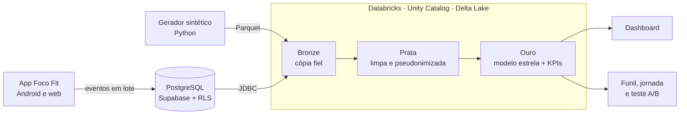
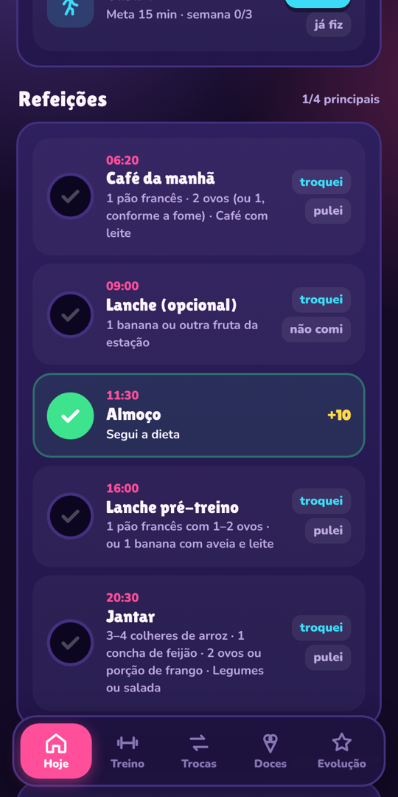
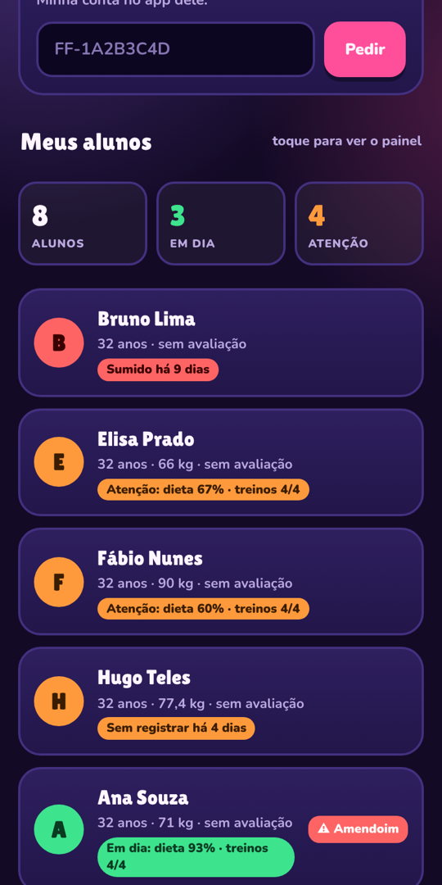
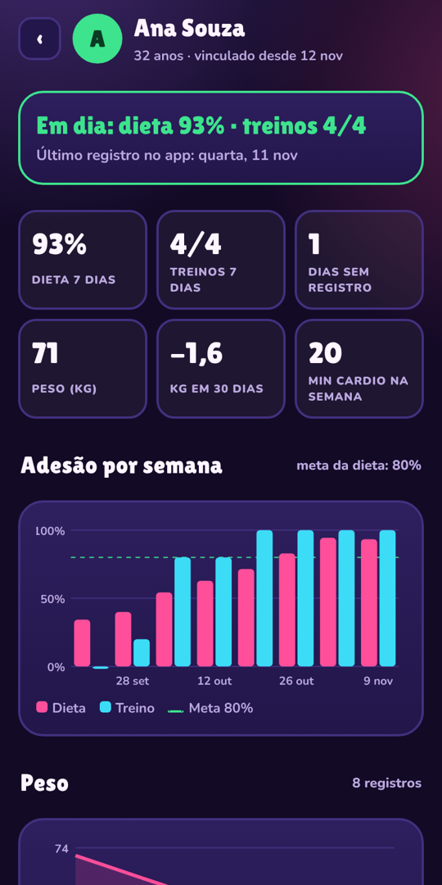
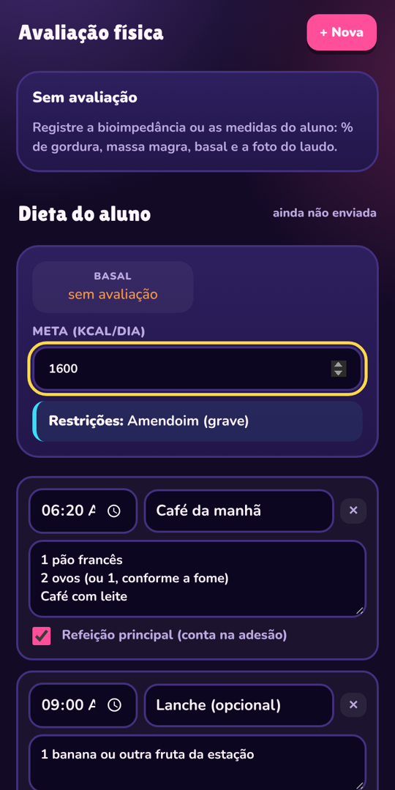

# Foco Fit · projeto de dados

Projeto de engenharia e análise de dados feito em cima de um app real de dieta e treino que eu desenvolvi, o **Foco Fit**. Começa no toque do aluno no celular e termina numa decisão de produto. É também o trabalho da minha pós-graduação em **Analytics e Business Intelligence (PUC Minas)**.

> **Em desenvolvimento.** Próximos passos: dashboard em Power BI sobre a camada ouro e um modelo que avisa quando um aluno está perto de desistir.

**Pergunta de negócio:** o que faz um aluno manter a rotina de dieta e treino, e como o personal identifica cedo quem vai desistir?

🎬 **Vídeo de 90 segundos:** [o caminho do dado, do app à decisão](midia/foco-fit-estrutura-de-dados.mp4)

## Arquitetura



| Camada | O que foi construído | Ferramentas | Onde está |
| --- | --- | --- | --- |
| Coleta | Contrato de eventos versionado (v1 e v2): telas, cadastro, refeições, treino, avisos, experimento | JSON, contrato em Markdown | [`analytics/docs/contrato-eventos.md`](analytics/docs/contrato-eventos.md) |
| Banco operacional | Modelo relacional (perfis, vínculos, planos, avaliações, eventos), 6 migrações versionadas, regras de acesso por linha, funções do painel do profissional | PostgreSQL, Supabase, SQL | [`supabase/migrations`](supabase/migrations) |
| Testes do banco | 117 checagens das regras de acesso rodando num Postgres em memória | PGlite, GitHub Actions | [`supabase/tests`](supabase/tests) |
| Dados simulados | 500 alunos e 20 profissionais em 6 meses, com perfis de comportamento e semente fixa | Python, pandas, NumPy, PyArrow, pytest | [`analytics/synthetic`](analytics/synthetic) |
| Lakehouse | Bronze, prata e ouro, checagens de qualidade, job agendado como código | Databricks, Unity Catalog, Delta Lake, PySpark, Spark SQL, Asset Bundles | [`analytics/databricks`](analytics/databricks) |
| Modelagem | Modelo estrela: `fato_aluno_dia`, fatos de refeição, treino, cardio, água e peso; dimensões de aluno, data, profissional e tipo de treino | Modelagem dimensional | [`03_ouro.py`](analytics/databricks/notebooks/03_ouro.py) |
| Análise | KPIs, funil de ativação, jornada a partir da notificação, sequência de dias (gaps and islands), teste A/B com Welch e CUPED | SQL com funções de janela, Python | [`case_funil_jornada.sql`](analytics/databricks/sql/case_funil_jornada.sql) |
| Governança | Pseudonimização do aluno com hash e sal em secret scope, dado sintético sempre separado do real, LGPD | Databricks secrets, RLS | [`analytics/docs/arquitetura.md`](analytics/docs/arquitetura.md) |

## Principais achados

Com os 500 alunos simulados (os padrões foram embutidos no gerador para testar o método; não são dados de pessoas reais):

| Achado | Número | O que eu recomendaria |
| --- | --- | --- |
| A maior perda não está no cadastro, e sim entre as semanas 2 e 4 | 88% ativos na semana 2 → 75% na semana 4 | Investir no hábito da 2ª semana em diante, não no onboarding |
| A primeira sequência de 7 dias separa quem fica de quem sai | Abandono de 21% (chegou a 7 dias) contra 53% (nunca chegou) | Meta de ativação: a primeira semana completa |
| Ter um personal vinculado se associa a mais retenção | 86% contra 74% ativos na semana 4 | Convidar para vincular um personal na semana 2 e medir com teste |
| Tocar no aviso e só abrir o app costuma terminar sem ação | 62% a 66% das sessões de treino, água e lembrete | Botão de ação direto no aviso |
| Teste A/B do botão "Fechar o dia" no aviso das 21 h | −3,2 ± 4,3 pontos (efeito mínimo detectável: 6,1) | Inconclusivo: não lançar e recalcular a amostra |

Os números de associação são correlações. Por isso cada recomendação vem com um teste A/B para confirmar.

## Telas do app

O app é a fonte dos dados. As telas abaixo são reais; os alunos são de teste.

| Aluno: refeições do dia | Personal: quem precisa de atenção | Painel do aluno | Nutri: monta a dieta |
| --- | --- | --- | --- |
|  |  |  |  |

O código do app fica num repositório privado. Aqui está a parte de dados.

## Como rodar

```bash
# regras de acesso do banco (Postgres em memória)
npm install && npm run test:db

# dados sintéticos
pip install -r analytics/synthetic/requirements.txt
cd analytics/synthetic
python gerar.py                # 500 alunos, 20 profissionais, 6 meses
python -m pytest -q tests
```

O passo a passo do lakehouse no Databricks Free Edition está em [`analytics/databricks/README.md`](analytics/databricks/README.md).

## Mais documentos

- [Arquitetura e decisões](analytics/docs/arquitetura.md)
- [Contrato de eventos](analytics/docs/contrato-eventos.md)
- [Catálogo de KPIs](analytics/docs/kpis.md)
- [Disciplinas da pós e entregas](analytics/docs/disciplinas.md)
- [Backlog](analytics/docs/backlog.md)

---

Todos os direitos reservados. O código está aqui para leitura e avaliação do trabalho.
